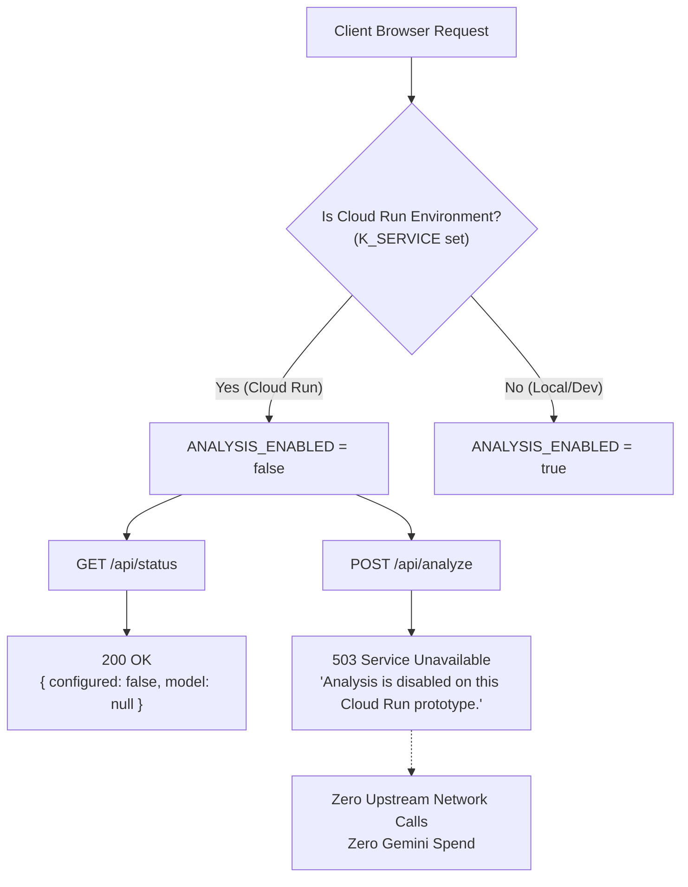

# LabelFit India: Cloud Run Guard & Local Security Review Notes

**Date:** November 2026  
**Audience:** Google Cloud Reviewers, Startup Buildathon India 2026 Jury, Technical Operations  
**Scope:** Server Architecture, Runtime Spend Locks, Security Headers, and Privacy Gates  
**Status:** Code and local test review — Cloud Run Analysis Guard **Hard-Locked**

---

## 1. Production Posture & Spend Lock Invariant

In this Buildathon prototype, **public Cloud Run multimodal analysis is intentionally disabled by design**:

```javascript
const IS_CLOUD_RUN = Boolean(process.env.K_SERVICE);
// This prototype has no sign-in or server-side spend limits. Keep Gemini calls
// disabled on Cloud Run until those controls are implemented and reviewed.
const ANALYSIS_ENABLED = !IS_CLOUD_RUN;
```

### Risk Rationale
1. **Uncontrolled Spend Exposure:** An unauthenticated public web endpoint making live multimodal Gemini calls can be automated or scraped, leading to rapid API quota depletion or unexpected Google Cloud bills.
2. **Absence of User Identity & Quotas:** Without durable per-user authentication (e.g. Google Cloud Identity Platform / Firebase Auth), in-memory IP rate limiting is insufficient for distributed public traffic.
3. **Privacy Review Precondition:** The intended use involves caregiver-facing food-label information. Obtain qualified privacy advice on the applicable DPDP Act and Rules, their commencement and scope, and the proposed data flow before a public pilot. This engineering audit does not determine legal applicability.

---

## 2. Code-Level Enforcement Architecture



### Verified Runtime Guarantees
1. **Automatic Environment Detection:** The server detects Google Cloud Run via the runtime environment variable `process.env.K_SERVICE`.
2. **Status Downgrade:** The source returns `{ configured: false, model: null }` when the disabled-analysis flag is active. A local unit test exercises this flag; no deployed Cloud Run instance was tested.
3. **Immediate Analysis Rejection:** `POST /api/analyze` checks the disabled-analysis flag before parsing the request body and returns HTTP `503 Service Unavailable` with `{ error: 'Analysis is disabled on this Cloud Run prototype.' }`. The API key may exist in the process environment, but this request path makes no Gemini call. The test sets the flag directly rather than launching an actual Cloud Run service.
4. **Origin Check:** `isAllowedOrigin` verifies same-origin requests, blocking external sites from issuing cross-origin requests (`HTTP 403`).
5. **Memory and Rate Bounds:** Local development enforces an in-memory sliding window rate limiter (max 10 requests / minute) and a concurrency limiter (max 2 parallel image processing jobs, returning `HTTP 429`).
6. **Payload Guard:** File uploads are strictly capped at 7 MB with base64 size checks and binary magic-number validation (JPEG `0xFFD8FF`, PNG `\x89PNG`, WebP `RIFF...WEBP`).

---

## 3. Security Headers & Application-Side Image Handling

Every response issued by `server.js` attaches strict production security headers:

| Security Header | Configured Value | Operational Purpose |
| :--- | :--- | :--- |
| **`Cache-Control`** | `no-store` | Prevents browser or proxy caching of label data. |
| **`X-Content-Type-Options`** | `nosniff` | Blocks MIME-type sniffing attacks. |
| **`X-Frame-Options`** | `DENY` | Prevents clickjacking and framing. |
| **`Referrer-Policy`** | `no-referrer` | Prevents URL or path leakage in referrer headers. |
| **`Permissions-Policy`** | `camera=(), microphone=(), geolocation=()` | Blocks browser hardware access. |
| **`Content-Security-Policy`** | `default-src 'self'; script-src 'self'; style-src 'self'; img-src 'self' blob: data:; connect-src 'self'; font-src 'self'; object-src 'none'; base-uri 'none'; frame-ancestors 'none'; form-action 'self'` | Strict allowlist; zero third-party scripts or CDNs. |

### Application-Side Handling (not a provider retention guarantee)
- **API Store Flag:** All Gemini Interactions requests explicitly declare `"store": false`.
- **No Intentional Application Writes:** The current request path does not intentionally write uploaded images to an application file or database. Process memory and runtime infrastructure are not secure-erasure guarantees.
- **Provider Terms Still Apply:** `store: false` controls Interactions object storage; it does not promise zero retention or change the provider's service-tier terms, abuse monitoring, or processing. The UI notice must remain visible and the selected account tier must be documented before any pilot.
- **Zero Child Data:** The application collects no user names, email addresses, child profiles, infant ages, or locations.

---

## 4. Pre-Production Unlock Gates

Before `ANALYSIS_ENABLED` can be switched on in Cloud Run, the following five production controls must be implemented and signed off:

1. **Gate 1 — User Authentication:** Integrate Google Cloud Identity Platform or Firebase Auth to enforce verified adult user accounts.
2. **Gate 2 — Durable Rate & Quota Controls:** Replace in-memory rate limiting with Redis (Cloud Memorystore) or Firestore to enforce durable daily scan quotas (e.g., maximum 5 scans per user per day).
3. **Gate 3 — Cloud Billing Budget Kill-Switch:** Deploy a Cloud Functions Pub/Sub webhook listening to Google Cloud Billing budget alerts to automatically stop the Cloud Run service if monthly spend reaches a defined threshold (e.g. \$50).
4. **Gate 4 — DPDP Act 2023 Legal Review:** Obtain qualified Indian privacy counsel sign-off documenting notice and consent standards for child-adjacent packaging transcription.
5. **Gate 5 — FSSAI Domain Advisory Sign-Off:** Review literal transcription prompts with food safety specialists to re-verify non-prescriptive boundaries.

---

## 5. Automated Verification Summary

All Step 5 production guards are continuously validated by the automated test suite:

- **Node.js Integration Tests:**
  - `✔ Step 5: Cloud Run status endpoint reports unconfigured when analysis is disabled`
  - `✔ Step 5: Cloud Run analysis guard hard-disables analysis and returns 503`
  - `✔ Step 5: Strict security headers are attached on all responses`
  - `✔ 7. Smoke Test: Cloud Run analysis guard is hard-disabled`
- **Result:** 28/28 Node tests passing; 32/32 Python tests passing.
