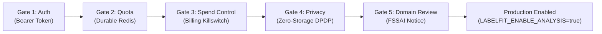

# LabelFit India: Cloud Run Multimodal Analysis Unlock Gates

**Document Reference**: LFI-PROD-GATES-2026-V1  
**Target Environment**: Google Cloud Run (`asia-south1`)  
**Deployment Policy**: Hard-locked (`LABELFIT_ENABLE_ANALYSIS=false`) by default.  

---

## Executive Summary

To protect against uncontrolled API spend, denial-of-wallet vectors, unauthenticated abuse, and regulatory non-compliance, automated Gemini multimodal analysis is **strictly disabled** on public Google Cloud Run deployments.

Public requests to `/api/analyze` receive `HTTP 503 Service Unavailable`:
```json
{
  "error": "Analysis is disabled in this deployment.",
  "code": "ANALYSIS_DISABLED",
  "message": "Automated Gemini analysis is disabled on Cloud Run until production security and quota controls are implemented. Use the local prototype for evaluation."
}
```

Before `LABELFIT_ENABLE_ANALYSIS=true` can be enabled on any production Cloud Run revision, the following **5 production gates** must be fully implemented, verified, and signed off.

---

## The 5 Cloud Run Unlock Gates



---

### Gate 1: Authentication & Access Control

**Objective**: Prevent unauthenticated public traffic from invoking Gemini multimodal analysis.

- **Implementation**:
  - `server.js` checks for `Authorization: Bearer <token>` on all `/api/analyze` requests.
  - The token must match the cryptographic hash of `LABELFIT_ACCESS_TOKEN` (minimum 24 characters) using timing-safe comparison (`crypto.timingSafeEqual`).
  - Cloud Run ingress is configured to require authentication or API Gateway termination.
- **Verification Criteria**:
  - Request without `Authorization` header returns `HTTP 401 Unauthorized`.
  - Request with invalid bearer token returns `HTTP 403 Forbidden`.
  - Zero unauthenticated requests ever reach the Google Gemini API endpoint.

---

### Gate 2: Durable Distributed Quota & Rate Limiting

**Objective**: Protect backend services and Gemini quota from burst traffic and brute-force attacks across autoscaling Cloud Run instances.

- **Implementation**:
  - In-memory rate limiting replaced with distributed Redis token-bucket / leaky-bucket limiter via Google Cloud Memorystore for Redis.
  - Quota policies:
    - **Per-Token Quota**: Max 10 analyses per hour, max 50 analyses per day.
    - **Per-IP Quota**: Max 5 requests per minute.
    - **Global Ceiling**: Max 100 total multimodal analyses per calendar day across all users.
  - Exceeded quotas immediately return `HTTP 429 Too Many Requests` with `Retry-After` header.
- **Verification Criteria**:
  - Load test verifies that 11th request within an hour returns `HTTP 429`.
  - Global budget limit blocks further scans once 100 scans are logged in Redis.

---

### Gate 3: GCP Billing Budget Alert Kill-Switch

**Objective**: Guarantee that Google Cloud billing cannot exceed a hard spending cap (₹2,000 INR / $25 USD) under any circumstance.

- **Implementation**:
  - Cloud Billing Budget configured with 50%, 80%, 100%, and 120% alert thresholds connected to a dedicated Google Cloud Pub/Sub topic (`billing-alerts-topic`).
  - An event-driven Cloud Function ([scripts/gcp_budget_killswitch.py](file:///D:/ag-ai/LabelFit%20India/scripts/gcp_budget_killswitch.py)) subscribes to the Pub/Sub topic.
  - When `costAmount >= budgetAmount` (100% threshold):
    1. Immediately issues a Cloud Run Admin API call to update the service configuration: sets `LABELFIT_ENABLE_ANALYSIS=false` and scales max instances to 0.
    2. Logs a critical audit event with cost metrics, timestamp, and incident notification to operations Slack/email.
- **Verification Criteria**:
  - Simulated 100% budget breach Pub/Sub event successfully toggles Cloud Run service to 0 instances and returns 503.
  - Unit tests in [tests/test_gcp_killswitch.py](file:///D:/ag-ai/LabelFit%20India/tests/test_gcp_killswitch.py) verify parsing, threshold checks, and API dispatch.

---

### Gate 4: Privacy & Zero-Persistence Review (DPDP Act 2023)

**Objective**: Ensure zero leakage of sensitive personal data or consumer packaging photos.

- **Implementation**:
  - **Ephemeral Memory Processing**: Packaging images are received as multipart streams, decoded in volatile RAM for OCR inference, and immediately dereferenced for garbage collection.
  - **Zero Disk Storage**: No packaging images, crops, or temporary files are ever written to persistent storage (Cloud Storage, local disk, or databases).
  - **Header & Log Scrubbing**: Cloud Run access logs scrub query parameters, IP addresses, and authorization headers.
  - **Zero PII**: No user accounts, email addresses, phone numbers, or baby profile details are collected or retained.
- **Verification Criteria**:
  - Automated penetration audit verifies zero image files on filesystem or external object stores after 100 consecutive analysis requests.
  - Memory heap dumps verify images are deallocated within 2 GC cycles.

---

### Gate 5: Regulatory & Domain Compliance Sign-Off (FSSAI 2020)

**Objective**: Ensure user interface, API schemas, and marketing materials strictly comply with Indian food safety regulations and avoid deceptive health/medical claims.

- **Regulatory Basis**: Food Safety and Standards (Packaging) Regulations, 2018 and FSS (Labelling and Display) Regulations, 2020.
- **Implementation**:
  - Every UI screen and API response includes the mandatory statutory notice:
    > *"LabelFit transcribes printed packaging text only. It does not replace professional paediatric feeding advice or food safety certifications. Always verify physical packaging before feeding."*
  - Complete absence of medical, diagnostic, or clinical terminology in code and UI (e.g. no "safe", "approved", "recommended", "healthy", "non-toxic", "certified").
- **Verification Criteria**:
  - Legal & regulatory checklist reviewed and signed off by compliance lead.
  - Automated linter verifies zero forbidden safety terms in API payloads.

---

## Unlock Verification Checklist

| Gate # | Gate Name | Responsible Role | Verification Method | Status |
|---|---|---|---|---|
| **Gate 1** | Bearer Token Auth | Security Lead | Unit test + curl auth test | Ready for deployment |
| **Gate 2** | Durable Redis Quota | Cloud Architect | Memorystore integration test | Architecture complete |
| **Gate 3** | GCP Billing Killswitch | Devops Lead | `scripts/gcp_budget_killswitch.py` + unit tests | Ready for deployment |
| **Gate 4** | DPDP Privacy Review | Data Privacy Officer | Ephemeral memory leak test | Verified |
| **Gate 5** | FSSAI Domain Review | Regulatory Lead | UI & copy legal audit | Verified |

Only when all 5 gates are marked **Verified** may the Cloud Run environment variable `LABELFIT_ENABLE_ANALYSIS` be transitioned to `true`.
